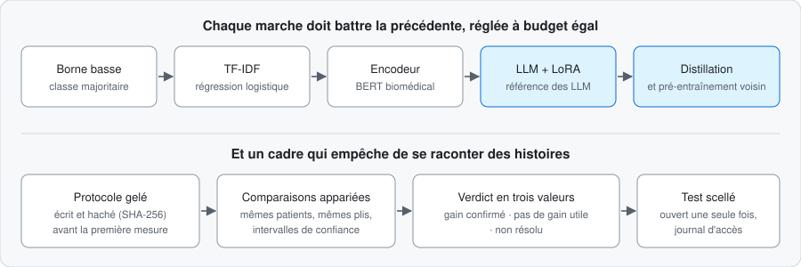

# LLM-Engineering

**Faire rendre à un LLM la bonne réponse, au format attendu, et mesurer quelle stratégie d'optimisation paie vraiment.**
Cas d'étude : prédire le chapitre CIM-10 du diagnostic (17 classes) à partir de comptes rendus cliniques **fictifs**
(corpus PARHAF), sur une seule carte graphique (RTX 5090). Aucune donnée de patient réel.

**[▶ Ouvrir le plan interactif des tests](https://cyril-bgs-dev-tech.github.io/llm-engineering/)** · **[Code public](https://github.com/cyril-bgs-dev-tech/llm-engineering)**

## Stratégies comparées

- **Affinage LoRA** de Qwen3.5-4B, retenu après un criblage de modèles Qwen et Gemma
- **Distillation** vers un encodeur, **compression** (INT8, élagage), **ensembles**, empilement, **cascade**
- Face à des **références fortes et réglées** : TF-IDF, encodeur CamemBERT-bio, zéro-shot

## Ce qui a été mesuré

| Question | Résultat | Verdict |
|---|---|---|
| Test scellé (633 patients, ouvert une seule fois) : système final contre le meilleur TF-IDF | macro-F1 0,8131 contre 0,7402, +7,28 points [+1,55 ; +12,62] | **non résolu** au seuil d'utilité de 2 points, comme annoncé d'avance |
| Gain de l'affinage LoRA sur le même modèle en zéro-shot | +28,8 points [+22,5 ; +35,0] | gain |
| MorFITT, benchmark public, système transposé sans réglage | F1 pondéré 72,30 [70,15 ; 74,35] contre 71,95 pour le meilleur chiffre publié | au niveau du meilleur publié, pas au-dessus |
| Cascade : l'ensemble léger répond seul quand il est sûr | même qualité (−0,10 [−0,23 ; +0,02]), 82 % des patients sans le LoRA, latence attendue 38,4 ms contre 97,4, énergie divisée par 3,5 | retenue |
| Incertitude au test | couverture conforme 0,924 pour 0,90 visé ; exactitude 0,962 en renvoyant 30 % des cas à un humain | la pire famille de chapitres reste sous la cible |
| Distillation, INT8 statique, élagage, empilement, lissage, moyenne de poids, curriculum | aucun gain ne tient | **sept résultats négatifs publiés** |

## Protocole

- Règles gelées et hachées avant la première mesure ; seuil d'utilité fixé à 2 points ; bootstrap par blocs d'auteurs
- Test scellé ouvert une seule fois ; prédictions préenregistrées, notées ensuite (4 réussies sur 6)
- Chaque chiffre renvoie à un run du registre ; 616 tests ; chiffre clé reconstruit à l'identique depuis un clone neuf

**Stack** : Python · PyTorch · Transformers · PEFT · TRL · scikit-learn · ONNX · Docker · pytest
