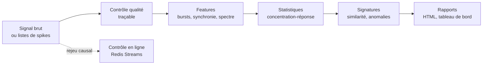

# 🧠 NeuroSig : signatures de composés en électrophysiologie (MEA)

**En une phrase** : une chaîne d'analyse qui transforme des enregistrements de neurones cultivés sur puces multi-électrodes (MEA) en signatures exploitables pour caractériser l'effet de composés chimiques.

**Contexte** : projet personnel d'initiation, réalisé à titre de test  
**Domaine** : électrophysiologie, traitement du signal, statistiques concentration-réponse  
**Données** : sources publiques (essais MEA de l'US EPA, jeux de données publiés avec articles scientifiques)

---

## 🧑‍💼 Vue d'ensemble

**Le problème** : quand on expose des neurones à un composé, leur activité électrique change (fréquence de décharge, salves, synchronie). Encore faut-il détecter correctement chaque potentiel d'action dans un signal bruité, écarter les électrodes douteuses et ajuster proprement une courbe concentration-réponse. Chaque étape mal faite fausse la signature finale.

**Ce que fait le projet** : il couvre toute la chaîne, du signal brut à la signature du composé, et vérifie chaque maillon avant de passer au suivant.

**Ce que ça démontre** : la capacité à reproduire une méthode de référence publiée, puis à construire au-dessus une chaîne d'analyse dont chaque algorithme est prouvé avant d'être appliqué aux données réelles.

## De l'enregistrement à la signature

---

## 📊 Résultats clés

| Mesure | Résultat |
|---|---|
| Reproduction de la méthode de l'US EPA | **33 008** ajustements concentration-réponse refaits, **même modèle retenu dans 98,3 %** des cas (kappa 0,964) |
| Détection de spikes, filtrage repensé | micro-F1 de détection de **0,686 à 0,999** sur un banc hybride de 192 électrodes |
| Validation | chaque algorithme validé sur **vérité terrain synthétique** avant les données réelles |
| Qualité logicielle | **2 486 tests**, intégration continue GitLab, données versionnées sous DVC |

---

## 🔬 Méthode

- **Reproduire avant d'innover** : la méthode d'ajustement de l'US EPA est refaite d'abord, et l'accord mesuré (98,3 %, kappa 0,964) avant toute extension.
- **Vérité terrain synthétique** : chaque algorithme (détection, bursts, synchronie, connectivité) est d'abord testé sur des signaux dont on connaît la réponse exacte.
- **Contrôle qualité traçable** : chaque décision du contrôle qualité peut être relue et justifiée.
- **Reproductibilité** : données versionnées (DVC), tests automatisés à chaque modification.

---

## 🛠️ Stack technique

| Catégorie | Technologies |
|---|---|
| **Langage** | Python |
| **Données** | Polars, DuckDB |
| **Statistiques** | statsmodels |
| **Électrophysiologie** | Elephant |
| **Pipeline** | Redis Streams |
| **Reproductibilité** | DVC, CI GitLab |

---

## 🎯 Compétences démontrées

- **Traitement du signal** : filtrage, détection d'événements, analyse spectrale
- **Statistiques** : modèles concentration-réponse, sélection de modèle, mesure d'accord
- **Rigueur scientifique** : reproduction d'une référence publiée, validation sur vérité terrain
- **Ingénierie** : chaîne testée de bout en bout, données versionnées

---

**Code source** : dépôt privé, accès sur demande  
**Dernière mise à jour** : novembre 2026  
**Contact** : cyril.bgs.dev@gmail.com
