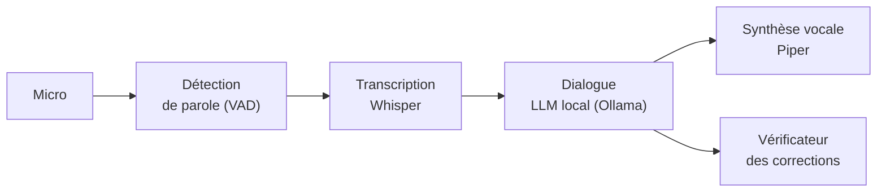

# 🎙️ Prof Anglais : application vocale d'anglais professionnel, 100 % locale

**En une phrase** : une application qui fait pratiquer l'anglais à l'oral dans des réunions professionnelles simulées, adaptées au métier de l'utilisateur, avec des modèles qui tournent entièrement sur la machine.

**Contexte** : projet personnel  
**Période** : octobre 2026, en cours

---

## 🧑‍💼 Vue d'ensemble

**Le problème** : on progresse à l'oral en parlant, pas en lisant. Or s'entraîner à une vraie réunion en anglais demande un interlocuteur disponible, patient et qui connaît le vocabulaire du métier.

**Ce que fait l'application** : l'utilisateur choisit une mission (une réunion de son métier), parle au micro, et un modèle de langage local lui répond à voix haute, le corrige et l'évalue. Le vocabulaire est ensuite révisé en répétition espacée.

**Ce que ça démontre** : la capacité à assembler une chaîne vocale complète avec des modèles locaux, et surtout à **mesurer** le comportement du modèle au lieu de le supposer.

## La chaîne vocale

---

## 📊 Résultats clés

| Mesure | Résultat |
|---|---|
| Contenu | **20 missions** sur **8 métiers**, **534 mots** en répétition espacée (FSRS), **6 jeux vocaux** |
| Réactivité | de la fin de parole au premier son : médiane passée de **2,2 s à 1,2 s** (même protocole), **0,8 à 1,0 s** avec le silence le plus court proposé |
| Fiabilité des corrections | un vérificateur séparé ramène les corrections à tort de **53 sur 54 à 1 sur 52** |
| Fonctionnement local | sans clé API, fonctionnement vérifié réseau coupé |
| Tests | parcours réel testé de bout en bout dans le navigateur, micro simulé |

Les mesures ont été faites avec des voix de synthèse et un micro simulé ; un test sur un vrai accent est prévu.

---

## 🔬 Méthode

- **Mesurer le modèle** : un banc dédié compte les corrections injustifiées du modèle, ce qui a conduit à ajouter un vérificateur séparé.
- **Gagner du temps sans tricher** : la réponse se prépare pendant le silence de l'apprenant et n'est jouée que s'il a vraiment fini ; sinon elle est jetée.
- **Évaluation après chaque séance** pour suivre la progression.
- **Tests de bout en bout** dans un vrai navigateur, avec un micro simulé.

---

## 🛠️ Stack technique

| Catégorie | Technologies |
|---|---|
| **Interface** | Next.js, TypeScript |
| **Backend** | FastAPI, SQLite |
| **Voix** | Whisper (transcription), Piper (synthèse) |
| **Modèle de langage** | Ollama, en local |
| **Apprentissage** | FSRS (répétition espacée) |

---

## 🎯 Compétences démontrées

- **Application LLM complète** : interface, backend, chaîne vocale
- **Évaluation du comportement d'un LLM** : mesure, correction, nouvelle mesure
- **Exécution locale** : modèles sur la machine, sans service externe obligatoire
- **Tests de bout en bout** d'une application vocale

---

**Code source** : dépôt privé, accès sur demande  
**Dernière mise à jour** : novembre 2026  
**Contact** : cyril.bgs.dev@gmail.com
